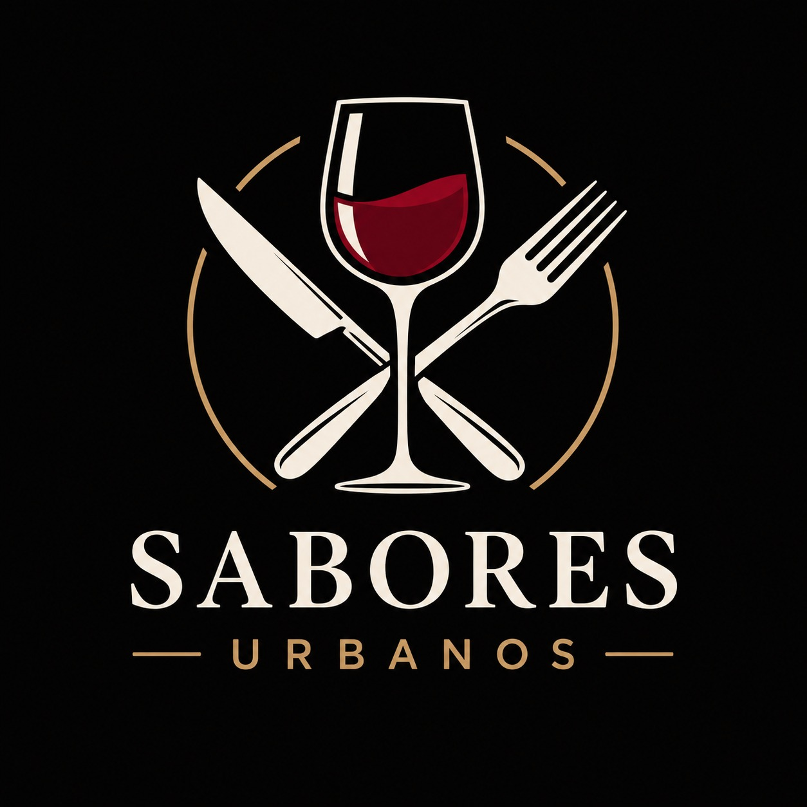

# Propuesta de solucion Sabores Urbanos

Se propone desarrollar un Sistema Web de Gestión Integral para Restaurantes que centralice la información de Sabores Urbanos, optimice sus procesos operacionales y facilite la coordinación entre los trabajadores. 
Para esta primera etapa, se seleccionaron tres requerimientos funcionales prioritarios: 

- RF1. Gestión y autenticación de usuarios: permitirá controlar el acceso al sistema según los perfiles y responsabilidades de cada trabajador.  

- RF5. Consulta de disponibilidad de mesas: facilitará la búsqueda de mesas considerando restaurante, fecha, hora, capacidad, estado y reservas existentes. 

- RF9. Apertura de pedidos asociados a mesas: permitirá al garzón registrar la apertura de pedidos, vinculándolos a una mesa, restaurante, fecha, hora y cliente opcional, evitando pedidos principales duplicados. 

Estas funcionalidades representan un flujo de atención que comienza con la autenticación del trabajador, continúa con la consulta de mesas disponibles y finaliza con la apertura del pedido. Su funcionamiento se representará mediante tres mockups. 

La propuesta constituye una primera etapa de desarrollo, dejando para futuras implementaciones la gestión de reservas (RF6), la incorporación de productos a los pedidos (RF10) y su seguimiento en cocina (RF11), permitiendo ampliar progresivamente el sistema. 

# Tecnologias Utilizadas

- React, Taildwind, React-router

# Uso

- npm i

- npm run server

- npm run dev
